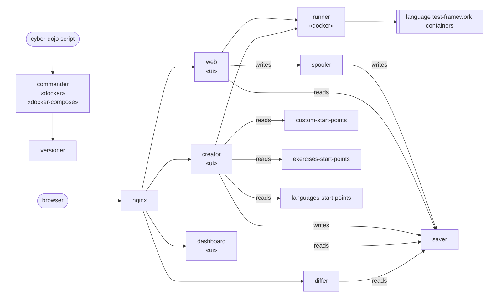

# Hi. Welcome to cyber-dojo :smile:

- [cyber-dojo](https://cyber-dojo.org) is where programmers meet to [practice](http://jonjagger.blogspot.co.uk/2013/10/practice.html) TDD
- this video explains how to use it for *group* TDD practice: https://youtu.be/OGGk-iFVOPQ
- this video explains how to use it for *individual* TDD practice: https://youtu.be/lIRF8MgyXho
- cyber-dojo is <em>not</em> an **IDE**, an **I**ndividual **D**evelopment **E**nvironment
- cyber-dojo <em>is</em> an **IDE**, an **I**nteractive **D**ojo **E**nvironment!
- cyber-dojo is about [shared](http://jonjagger.blogspot.co.uk/2013/10/teams.html) [learning](http://jonjagger.blogspot.co.uk/2013/10/learning.html)
- in a cyber-dojo you [practice](http://jonjagger.blogspot.co.uk/2013/10/practice.html) by going <em>slower</em> and focusing on [improving](http://jonjagger.blogspot.co.uk/2014/02/improving.html) rather than finishing
- [cyber-dojo foundation](http://blog.cyber-dojo.org/2015/08/cyber-dojo-foundation.html) is a registered Scottish Charitable Incorporated Organisation
- How can I [contribute to developing cyber-dojo](https://github.com/cyber-dojo/cyber-dojo/blob/master/CONTRIBUTING.md)?

- - - -
- Running a server
  * [on docker](#running-a-server-on-docker)
    - [setting up the server](#setting-up-the-server)
    - [running a plain docker server](#running-a-plain-docker-server)
    - [running a docker swarm server](#running-a-docker-swarm-server)
  * [on Kubernetes](#running-a-server-on-kubernetes)
- Versioning
  * [listing the current version](#listing-the-current-version)
  * [listing installed versions](#listing-installed-versions)
  * [updating the server to the latest version](#updating-the-server-to-the-latest-version)
  * [setting the server to a specific version](#setting-the-server-to-a-specific-version)
- Overriding the default...
  * [port](#overriding-the-default-port)
  * [runner spares](#overriding-the-default-runner-spares)
  * [start-point images](#overriding-the-default-start-point-images)
  * [nginx image](#overriding-the-default-nginx-image)
  * [web image](#overriding-the-default-web-image)
  * [dot env files](#overriding-the-default-dot-env-files)
- Misc
  * [List of MicroServices](#micro-services)
  * [Image dependencies](#image-dependencies)
  * [Domain model](#domain-model)
  * [Screenshots](#screenshots)
 
- - - -
# running a server on docker
A server runs natively on amd64 and arm64 hosts.

## setting up the server
1. Install Docker: [Docker Engine](https://docs.docker.com/engine/install/) on Linux,
   [Docker Desktop](https://docs.docker.com/desktop/) on a Mac.
   On Linux, only root and members of the `docker` group can use the docker
   daemon, so add yourself to that group, then log out and log in again:
   ```bash
   $ sudo usermod -aG docker $USER
   ```
2. Create the directories that saver and spooler keep their data in.
   On Linux, each must be owned by its service's user, saver (uid 19663)
   and spooler (uid 19664), both in group nogroup (gid 65533):
   ```bash
   $ sudo mkdir /cyber-dojo /cyber-dojo-spooler
   $ sudo chown 19663:65533 /cyber-dojo
   $ sudo chown 19664:65533 /cyber-dojo-spooler
   ```
   On a Mac:
   ```bash
   $ mkdir /Users/Shared/cyber-dojo /Users/Shared/cyber-dojo-spooler
   ```
3. Install the `cyber-dojo` script, and put it on your PATH:
   ```bash
   $ curl -O https://raw.githubusercontent.com/cyber-dojo/commander/main/cyber-dojo
   $ chmod 700 cyber-dojo
   ```

## running a plain docker server
```bash
$ cyber-dojo up
...
$ cyber-dojo version
Version: 0.1.497
   Type: public
...
```
Stop it with `cyber-dojo down`.

## running a docker swarm server
Make the host a swarm manager, then bring the server up as a stack:
```bash
$ docker swarm init
$ export CYBER_DOJO_SWARM=true
$ cyber-dojo up
...
$ docker stack ps cyber-dojo
```
saver and spooler run on the manager node, so the manager needs the
directories from the setup above.
Stop it with `cyber-dojo down`, with `CYBER_DOJO_SWARM` still exported.

- - - -
# running a server on Kubernetes
Follow [these instructions](https://github.com/cyber-dojo/k8s-install)

# listing the current version
```bash
$ cyber-dojo version
Version: 0.1.497
   Type: public
```

# listing installed versions
```bash
$ cyber-dojo version ls
0.1.497      2026-10-10 06:14:11 +0000 UTC
...
0.1.21       2019-08-07 11:51:48 +0000 UTC
...
```

# updating the server to the latest version
```bash
$ cyber-dojo update latest
$ cyber-dojo version
Version: 0.1.497
   Type: public
...
# Now make it live...
$ cyber-dojo up
Using version=0.1.497 (public)
...
```

# setting the server to a specific version
```bash
$ cyber-dojo update 0.1.462
$ cyber-dojo version
Version: 0.1.462
   Type: public
...
# Now make it live...
$ cyber-dojo up
Using version=0.1.462 (public)
...
```

# overriding the default port
By default your cyber-dojo server will be on port 80.
* Override this port using the command-line argument `--port`. Eg
  ```bash
  $ cyber-dojo up --port=8000
  ...
  Using port=8000
  ...
  ```

# overriding the default runner spares
By default the runner holds no spares, and each test run waits for its container to start.
* Have the runner hold pre-started containers, so test runs are faster,
  using the command-line argument `--runner-spares`. Eg
  ```bash
  $ cyber-dojo up --runner-spares=8
  ...
  Using runner-spares=8
  ...
  ```
* Each spare costs the host up to about 12MB of memory.

# overriding the default start-point images
* The `cyber-dojo up` command uses three default start-point images (tagged appropriately)
  - --custom=[cyberdojo/custom-start-points](https://hub.docker.com/r/cyberdojo/custom-start-points/tags)
  - --exercises=[cyberdojo/exercises-start-points](https://hub.docker.com/r/cyberdojo/exercises-start-points/tags)
  - --languages=[cyberdojo/languages-start-points](https://hub.docker.com/r/cyberdojo/languages-start-points/tags)
* You can create and use your own alternative start-point images in place of these defaults if you wish.
  - Read how to create them by running:
    ```
    cyber-dojo start-point create --help
    ```
  - Read how to use them by running:
    ```
    cyber-dojo up --help
    ```

# overriding the default nginx image
* By default your cyber-dojo server will use
[cyberdojo/nginx](https://hub.docker.com/r/cyberdojo/nginx/tags) as its nginx
service image (tagged appropriately).
* You can override this by exporting two
environment variables. Eg
  ```bash
  $ export CYBER_DOJO_NGINX_IMAGE=cucumber/nginx
  $ export CYBER_DOJO_NGINX_TAG=efd7e37
  $ cyber-dojo up ...
  ...
  Using nginx=cucumber/nginx:efd7e37
  ...
  ```

# overriding the default web image
* By default your cyber-dojo server will use
[cyberdojo/web](https://hub.docker.com/r/cyberdojo/web/tags)
as its web service image (tagged appropriately).
* You can override this by exporting two
environment variables. Eg
  ```bash
  $ export CYBER_DOJO_WEB_IMAGE=turtlesec/web
  $ export CYBER_DOJO_WEB_TAG=84d6d0e
  $ cyber-dojo up ...
  ...
  Using web=turtlesec/web:84d6d0e
  ...
  ```

# overriding the default dot env files
* There are default .env files for the `web` and `nginx` services.
* You can override these by exporting two environment variables
set to the absolute path of your own .env file. Eg
  ```bash
  $ export CYBER_DOJO_NGINX_ENV=/home/fred/my_nginx.env
  $ export CYBER_DOJO_WEB_ENV=/home/fred/my_web.env
  $ cyber-dojo up
  ...
  Using nginx.env=/home/fred/my_nginx.env (custom)
  Using web.env=/home/fred/my_web.env (custom)
  ...
  ```
When an exercise starts a welcome dialog displays
traffic-light information. You can turn off this dialog with
the following `web.env` entry:
  ```
  STARTING_INFO_DIALOG=off
  ```

You can turn off the review page's [fork] button
with the following `web.env` entry:
  ```
  FORK_BUTTON=off
  ```

You can turn off the [dashboard] button from the 
info toolbar with the following `web.env` entry:
  ```
  DASHBOARD_BUTTON=off
  ```

You can turn off traffic-light prediction with the
following `web.env` entry:
  ```
  PREDICT=off
  ```


- - - -
# Micro Services
Each repo in the github cyber-dojo organization builds a single docker image,
except web, which builds three (web, creator, and dashboard).  
The main Amazon ECS backed https://cyber-dojo.org uses:

| Service | CI | Role |
|---------|----|------|
| [custom-start-points](https://github.com/cyber-dojo/custom-start-points) | [](https://github.com/cyber-dojo/custom-start-points/actions) | serves the custom start-points |
| [exercises-start-points](https://github.com/cyber-dojo/exercises-start-points) | [](https://github.com/cyber-dojo/exercises-start-points/actions) | serves the exercises start-points |
| [languages-start-points](https://github.com/cyber-dojo/languages-start-points) | [](https://github.com/cyber-dojo/languages-start-points/actions) | serves the languages start-points |
| [differ](https://github.com/cyber-dojo/differ) | [](https://github.com/cyber-dojo/differ/actions) | diffs two sets of files |
| [nginx](https://github.com/cyber-dojo/nginx) | [](https://github.com/cyber-dojo/nginx/actions) | web-proxy, security, rate-limiting, images cache, and service routing |
| [runner](https://github.com/cyber-dojo/runner) | [](https://github.com/cyber-dojo/runner/actions) | runs the tests and returns `[stdout,stderr,status,timed_out,colour]` |
| [saver](https://github.com/cyber-dojo/saver) | [](https://github.com/cyber-dojo/saver/actions) | API to GET/POST group/kata data, e.g., for individual traffic-lights |
| [spooler](https://github.com/cyber-dojo/spooler) | [](https://github.com/cyber-dojo/spooler/actions) | buffers web's writes and forwards them, in order, to saver |
| [web](https://github.com/cyber-dojo/web/tree/main/app-web) | [](https://github.com/cyber-dojo/web/actions/workflows/main-web.yml) | main UX for coding, testing, and reviewing |
| [creator](https://github.com/cyber-dojo/web/tree/main/app-creator) | [](https://github.com/cyber-dojo/web/actions/workflows/main-creator.yml) | UI to configure and create (or re-enter) a group-exercise or an individual-exercise |
| [dashboard](https://github.com/cyber-dojo/web/tree/main/app-dashboard) | [](https://github.com/cyber-dojo/web/actions/workflows/main-dashboard.yml) | UI for a group session dashboard of all traffic-lights |

Locally running servers also use:

| Service | CI | Role |
|---------|----|------|
| [commander](https://github.com/cyber-dojo/commander) | [](https://github.com/cyber-dojo/commander/actions) | receives commands from the [cyber-dojo](https://github.com/cyber-dojo/commander/blob/main/cyber-dojo) shell script |
| [versioner](https://github.com/cyber-dojo/versioner) | [](https://github.com/cyber-dojo/versioner/actions) | holds consistent sets of image tags for all cyber-dojo services |

- - - -
# Image Dependencies



- - - -
# Domain Model


- - - -
# Screenshots


